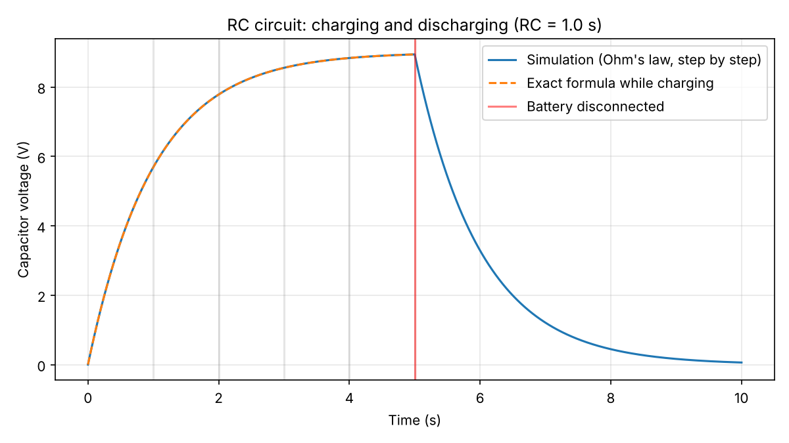

# Charging a Capacitor: The RC Circuit

**Question:** How long does a capacitor take to charge through a resistor, and why do engineers say it's full after 5 time constants?



## How it works

1. Uses Ohm's law to find the current at each tiny time step.
2. Adds that current's charge to the capacitor and updates its voltage.
3. Compares the simulation with the exact formula V = V₀(1 − e^(−t/RC)), then disconnects the battery to show discharging.

## Result

With 10 kΩ and 100 µF (RC = 1 s), the capacitor reaches 63% after 1 s, 95% after 3 s and 99.3% after 5 s, and the simulation matches the formula.

**Concepts:** Ohm's law, capacitors, exponential growth and decay, time constants

## Run it

```
pip install matplotlib
python rc_circuit.py
```

The program prints its results and saves the chart as `rc_circuit.png`.

## Try this next

- Build the circuit with a 9 V battery and a multimeter and compare with the program.
- Make a timer: find R and C so an LED switches off after 10 seconds.
- Simulate two capacitors in series or in parallel.

## What I learned

_Write 2–3 sentences in your own words: what surprised you, what was hard, and what you changed._
