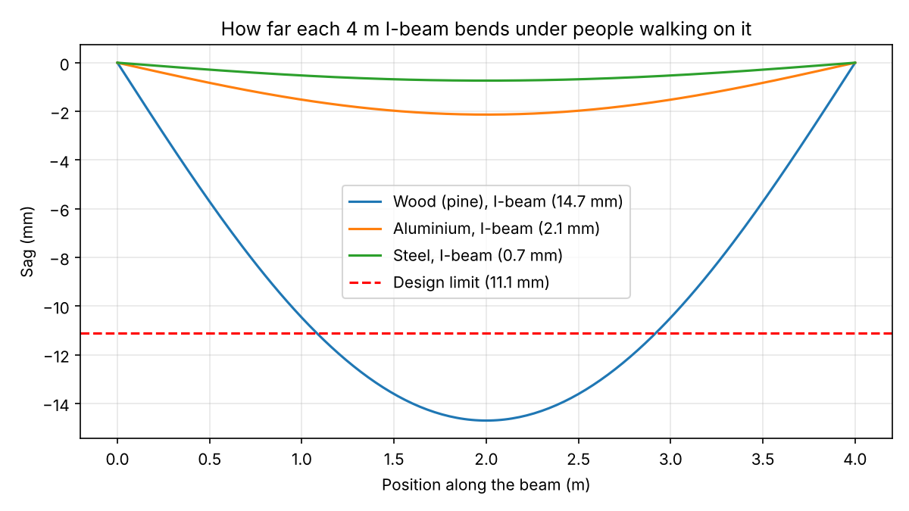

# Designing a Footbridge Beam

**Question:** Which material makes the stiffest 4 m footbridge beam, and why do real bridges use I-shaped beams?



## How it works

1. Uses the engineering formula for a beam supported at both ends with people spread along it.
2. Compares wood, aluminium and steel, as a solid square bar and as an I-beam made from the same amount of material.
3. Checks each design against a common rule: the sag must stay under span ÷ 360.

## Result

The I-beam is 5.4 times stiffer than the solid bar with the same weight of material. A steel I-beam sags only 0.7 mm; a wooden one sags 14.7 mm and fails the design rule.

**Concepts:** Stress and stiffness, Young's modulus, second moment of area, engineering design limits

## Run it

```
pip install matplotlib
python beam.py
```

The program prints its results and saves the chart as `beam.png`.

## Try this next

- Find the smallest wooden beam height that passes the design rule.
- Add a single heavy load in the middle instead of a spread-out load.
- Test real rulers or sticks with weights and compare with the formula.

## What I learned

_Write 2–3 sentences in your own words: what surprised you, what was hard, and what you changed._
