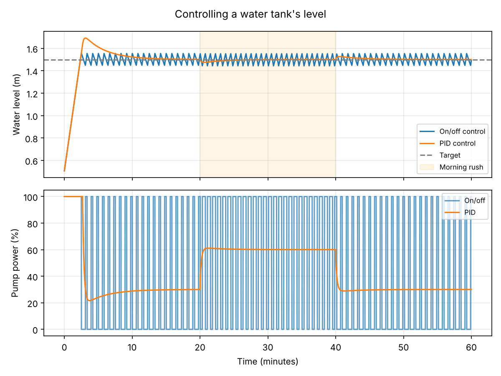

# Controlling a Village Water Tank

**Question:** How should a pump decide how hard to work so a water tank stays at the right level, even when people suddenly use more water?



## How it works

1. Simulates a tank that drains as water is used, with demand doubling during a morning rush.
2. Tests on/off control, which works like a thermostat.
3. Tests a PID controller, which sets the pump power from the error, its history and how fast it is changing.

## Result

The PID controller keeps the level within 0.5 cm of the target on average (on/off: 2.7 cm) and never switches the pump on and off, where on/off control switches it 144 times in an hour.

**Concepts:** Feedback control, PID controllers, rates of change, engineering trade-offs

## Run it

```
pip install matplotlib
python tank_control.py
```

The program prints its results and saves the chart as `tank_control.png`.

## Try this next

- Change the gains Kp, Ki and Kd one at a time and describe what each does.
- Add a sensor that is slightly noisy and see which controller copes better.
- Build it for real with an Arduino, a small pump and a distance sensor.

## What I learned

_Write 2–3 sentences in your own words: what surprised you, what was hard, and what you changed._
