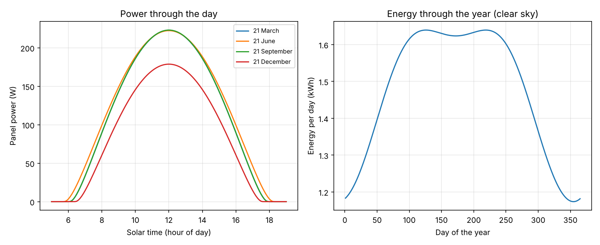

# Solar Power for a Home in Dangila

**Question:** How much electricity could one solar panel produce in Dangila, Ethiopia, and how does it change through the day and the year?



## How it works

1. Calculates the Sun's height in the sky from Dangila's latitude (11.26° N), the date and the time.
2. Estimates how much sunlight gets through the atmosphere and falls on a flat panel.
3. Adds up the panel's power over every day of the year.

## Result

On clear days one 300 W panel makes about 1.2–1.6 kWh a day and about 539 kWh a year, enough to run six LED bulbs for 5 hours every evening with energy to spare. The March and September lines overlap because the Sun follows almost the same path on those dates.

**Concepts:** Earth's tilt and the seasons, trigonometry, energy and power, renewable energy

## Run it

```
pip install matplotlib
python solar.py
```

The program prints its results and saves the chart as `solar.png`.

## Try this next

- Tilt the panel toward the south and find the best angle.
- Add the rainy season (June–September) by reducing sunlight on cloudy days.
- Size a battery that stores enough energy for one evening.

## What I learned

_Write 2–3 sentences in your own words: what surprised you, what was hard, and what you changed._
