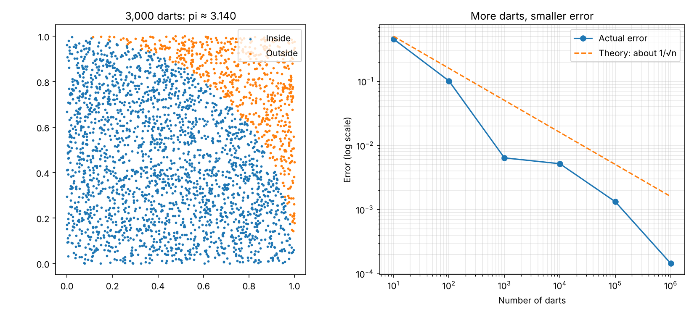

# Estimating π With Random Darts

**Question:** Can random numbers calculate π? And how fast does the answer improve as we use more of them?



## How it works

1. Throws random points into a 1×1 square with a quarter circle inside.
2. π ≈ 4 × (points inside the circle) / (all points).
3. Measures the error for 10 up to 1,000,000 points and compares it with the theory, error ≈ 1/√n.

## Result

With 1,000,000 darts the estimate is 3.14145, off by 0.00015. The error shrinks like 1/√n: 100× more darts gives about 10× more accuracy.

**Concepts:** Probability, area, the Monte Carlo method, the law of large numbers, logarithmic plots

## Run it

```
pip install matplotlib
python pi_estimate.py
```

The program prints its results and saves the chart as `pi_estimate.png`.

## Try this next

- Estimate the area of another shape, such as an ellipse, the same way.
- Rewrite it with numpy arrays and time how much faster it runs.
- Estimate π with Buffon's needle instead.

## What I learned

_Write 2–3 sentences in your own words: what surprised you, what was hard, and what you changed._
