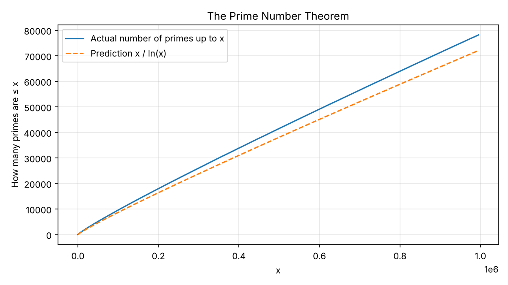

# Exploring Prime Numbers

**Question:** How are primes spread out, and does Goldbach's conjecture hold for the numbers we can check?



## How it works

1. Finds every prime up to 1,000,000 with the Sieve of Eratosthenes.
2. Compares the count with the Prime Number Theorem's prediction, x / ln(x).
3. Checks that every even number up to 100,000 is the sum of two primes.

## Result

There are 78,498 primes below one million. The ratio of the real count to x/ln(x) falls from 1.16 toward 1, and Goldbach's conjecture holds for every even number checked.

**Concepts:** Number theory, algorithms and their speed, logarithms, conjectures vs proofs

## Run it

```
pip install matplotlib
python primes.py
```

The program prints its results and saves the chart as `primes.png`.

## Try this next

- Look at twin primes (p and p + 2) and count how many there are.
- Draw the Ulam prime spiral.
- Time the sieve for larger N and estimate its running time.

## What I learned

_Write 2–3 sentences in your own words: what surprised you, what was hard, and what you changed._
