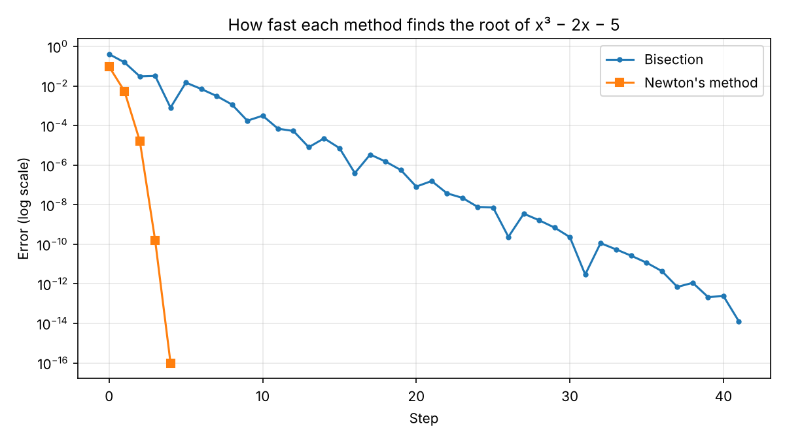

# Solving Equations: Newton's Method vs Bisection

**Question:** How can a computer solve an equation like x³ − 2x − 5 = 0, and why is Newton's method so much faster than halving an interval?



## How it works

1. Bisection keeps cutting an interval in half around the root.
2. Newton's method follows the tangent line: x_next = x − f(x)/f'(x).
3. Compares how many steps each needs, and computes √2 the same way.

## Result

Newton's method finds the root 2.094551481542 in 4 steps; bisection needs 42. The number of correct digits roughly doubles with each Newton step.

**Concepts:** Derivatives and tangent lines, iteration, convergence, error analysis

## Run it

```
pip install matplotlib
python newton.py
```

The program prints its results and saves the chart as `newton.png`.

## Try this next

- Find a starting point where Newton's method fails, and explain why.
- Use it to compute cube roots.
- Plot which root Newton's method reaches from each starting point (a Newton fractal).

## What I learned

_Write 2–3 sentences in your own words: what surprised you, what was hard, and what you changed._
