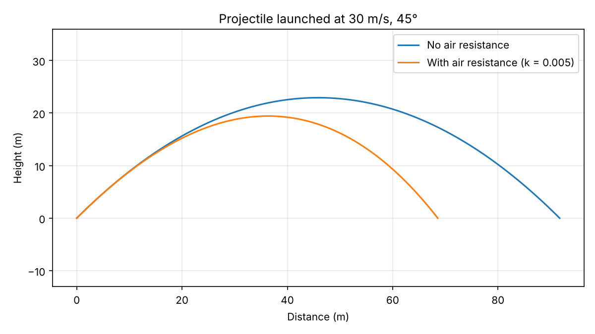

# Projectile Motion With Air Resistance

**Question:** How far does a launched ball travel, and how much does air resistance change the distance and the best launch angle?



## How it works

1. Uses the kinematics formulas to get the exact answer without air.
2. Simulates the flight in 1-millisecond steps with quadratic drag (force ∝ speed²).
3. Checks the simulation against the formula, then tries every angle from 1° to 89° to find the best one with air.

## Result

At 30 m/s and 45°, air resistance cuts the distance from 91.7 m to 68.6 m, and the best angle drops from 45° to about 43°.

**Concepts:** Kinematics, vectors, Newton's second law, numerical simulation (Euler's method)

## Run it

```
pip install matplotlib
python projectile.py
```

The program prints its results and saves the chart as `projectile.png`.

## Try this next

- Measure a real throw (phone video) and fit the drag constant k.
- Add wind blowing toward or against the ball.
- Launch from a cliff instead of the ground.

## What I learned

_Write 2–3 sentences in your own words: what surprised you, what was hard, and what you changed._
