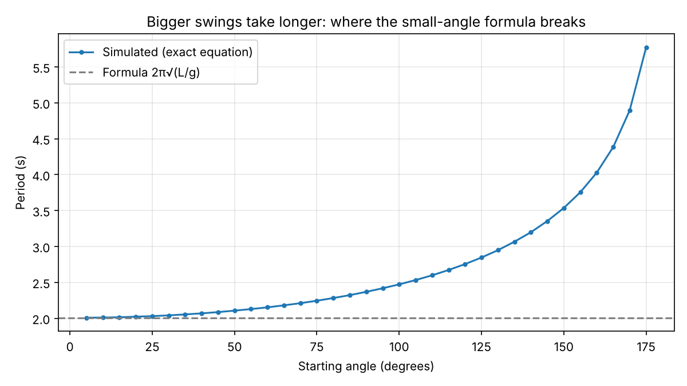

# When the Pendulum Formula Breaks

**Question:** The school formula T = 2π√(L/g) assumes small swings. How wrong is it for big swings?



## How it works

1. Simulates the exact pendulum equation θ'' = −(g/L)·sin θ step by step.
2. Times one full swing for starting angles from 5° to 175°.
3. Compares each period with the formula.

## Result

The formula is within 0.4% up to 15°, but off by 15% at 90° and by 59% at 170°.

**Concepts:** Simple harmonic motion, small-angle approximation sin θ ≈ θ, numerical simulation

## Run it

```
pip install matplotlib
python pendulum.py
```

The program prints its results and saves the chart as `pendulum.png`.

## Try this next

- Build a real pendulum, time 10 swings at different angles and compare with the program.
- Add air resistance so the swing slowly dies out.
- Plot the angle against time for a small and a large swing.

## What I learned

_Write 2–3 sentences in your own words: what surprised you, what was hard, and what you changed._
