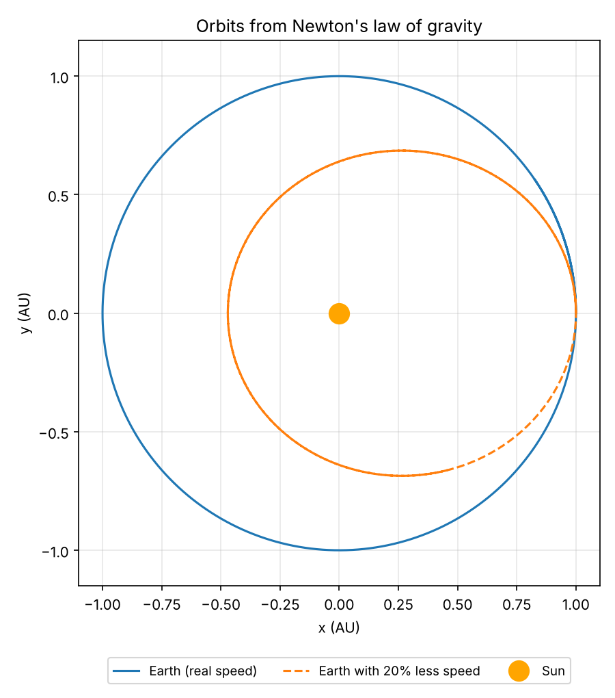

# Earth's Orbit From Newton's Law of Gravity

**Question:** Knowing only Newton's law of gravity and Earth's distance and speed, can a computer predict the length of a year?



## How it works

1. Computes the Sun's gravitational pull on Earth every simulated hour.
2. Moves Earth with the velocity Verlet method, which keeps orbits stable.
3. Detects one full orbit and checks that energy stays constant.

## Result

The simulation predicts a 365.2-day year (real value 365.25). With 20% less speed, Earth falls into an oval orbit and a year lasts about 230 days.

**Concepts:** Newton's law of universal gravitation, circular and elliptical orbits, Kepler's laws, conservation of energy

## Run it

```
pip install matplotlib
python orbit.py
```

The program prints its results and saves the chart as `orbit.png`.

## Try this next

- Add Mars and Venus and compare their years with real data.
- Check Kepler's third law: T² ∝ r³.
- Swap in simple Euler's method and watch the orbit spiral out. Explain why.

## What I learned

_Write 2–3 sentences in your own words: what surprised you, what was hard, and what you changed._
